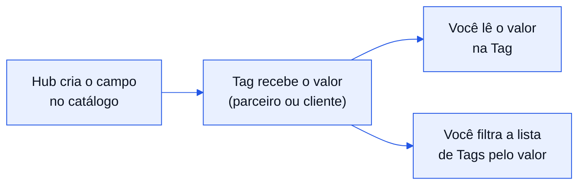

Uma Tag diz qual aparelho está com qual cliente. Mas o seu sistema quase sempre precisa guardar mais: a placa do veículo, o
chassi, o nome do condutor, o número do contrato. Os campos personalizados servem para isso. Você define quais dados existem e
depois preenche o valor de cada um em cada Tag, tudo pela API.

## Como funciona

Há três peças.

<CardGroup cols={3}>
  <Card title="Catálogo" icon="list">
    A lista de campos que existem na sua rede, como `placa` e `chassi`. Quem define é o parceiro principal (o hub).
  </Card>
  <Card title="Valores" icon="pen-to-square">
    O texto que cada Tag tem em cada campo. Você grava por vínculo, um valor por campo.
  </Card>
  <Card title="Visibilidade" icon="eye">
    Se o cliente vê o campo e se pode alterá-lo. Isso decide quem escreve o valor.
  </Card>
</CardGroup>



## Quem vê e quem escreve cada campo

Dois interruptores, `customer_visible` e `customer_editable`, definem as três combinações possíveis de um campo:

| `customer_visible` | `customer_editable` | O cliente | O parceiro (você) |
|---|---|---|---|
| `false` | `false` | Não vê o campo. | Lê e grava. |
| `true` | `false` | Vê o valor, não altera. | Lê e grava. |
| `true` | `true` | Vê e altera o valor. | Só lê. A API não deixa o parceiro sobrescrever. |

Um campo editável pelo cliente precisa ser visível: `customer_editable` igual a `true` com `customer_visible` igual a `false`
responde `422`. Escolha com cuidado ao criar: se você liga `customer_visible`, o cliente passa a ver o campo e o que estiver
gravado nele.

## O que vale para todo campo

- **O valor é sempre um texto de até 255 caracteres**, ou `null` para limpar. A API não tem campo numérico, de data ou de lista:
  guarde esses dados como texto, no formato que o seu sistema entende.
- **A `key` é o nome estável do campo.** Só letras minúsculas, números e sublinhado, começando por letra, com até 50 caracteres.
  Você a usa para gravar e para filtrar. Ela não muda depois de criada. O `label` é o nome que as pessoas leem e pode mudar.
- **Não existe exclusão.** Um campo criado só pode ser desativado. Campo desativado não recebe valor novo, mas os valores que já
  estavam nele continuam lá.
- **Existe um teto de campos por rede**, contando também os desativados. A listagem do catálogo mostra o teto (`meta.limit`) e
  quantos já existem (`meta.count`). Quando o teto é atingido, a criação responde `422`.
- **Valor padrão é copiado uma única vez.** Se o campo tem `default_value`, ele é gravado numa Tag no momento em que a Tag recebe
  o primeiro valor de qualquer campo. Mudar o padrão depois não altera Tags que já o receberam.
- **Só o hub administra o catálogo.** Uma filial grava valores nas Tags dela, usando os campos do catálogo do hub, mas não
  cria nem edita campo.

## Passo a passo

<Steps>
  <Step title="Crie o campo">
    O hub cria o campo uma vez, com [Criar campo no catálogo](/referencia/vinculos-e-campos/criar-campo-do-catalogo). Para
    placa e chassi, por exemplo, `key` igual a `placa` e `key` igual a `chassi`, com `customer_visible` e `customer_editable`
    desligados se só a sua equipe os preenche. Use [Listar o catálogo de campos](/referencia/vinculos-e-campos/listar-campos-do-catalogo)
    para conferir o que já existe.
  </Step>
  <Step title="Vincule o aparelho ao cliente">
    Os valores pertencem à Tag, então só existem depois do [vínculo](/referencia/vinculos-e-campos/vincular-dispositivo).
  </Step>
  <Step title="Grave os valores">
    Com [Gravar os campos de um vínculo](/referencia/vinculos-e-campos/gravar-campos-do-vinculo), envie um objeto `values` com a
    `key` de cada campo e o texto. A gravação é parcial (o que você não envia não muda) e vale tudo ou nada: se um item for
    recusado, nenhum é gravado.
  </Step>
  <Step title="Leia ou filtre">
    [Ler os campos de um vínculo](/referencia/vinculos-e-campos/ler-campos-do-vinculo) devolve os campos de uma Tag.
    [Listar Tags](/referencia/rastreamento/listar-tags) traz os campos de todas as Tags de uma vez com `include=custom_fields`,
    e filtra por valor com `filter[custom_fields][placa]=ABC1D23`.
  </Step>
</Steps>

## Um exemplo de ponta a ponta

Criar o campo `placa` (visível ao cliente, mas só o parceiro grava):

```bash
curl --request POST "https://core.clubtrack.com.br/api/b2b/v1/custom-fields" \
  --header "X-Api-Key: $CLUBTRACK_API_KEY" \
  --header "Content-Type: application/json" \
  --data '{ "key": "placa", "label": "Placa", "customer_visible": true, "customer_editable": false }'
```

Gravar a placa numa Tag:

```bash
curl --request PATCH "https://core.clubtrack.com.br/api/b2b/v1/tag-bindings/019a0f3c-a000-7d36-b6e0-c918528fd00a/custom-fields" \
  --header "X-Api-Key: $CLUBTRACK_API_KEY" \
  --header "Content-Type: application/json" \
  --data '{ "values": { "placa": "ABC1D23" } }'
```

Achar a Tag pela placa:

```bash
curl --get "https://core.clubtrack.com.br/api/b2b/v1/tags" \
  --header "X-Api-Key: $CLUBTRACK_API_KEY" \
  --data-urlencode "filter[custom_fields][placa]=ABC1D23" \
  --data-urlencode "include=custom_fields"
```

<Warning>
  As três chamadas gravam ou leem dados reais. Não existe ambiente de teste.
</Warning>

## Quando a funcionalidade não está ligada

Campos personalizados é uma funcionalidade ligada por parceiro. Se ela não estiver ligada para o seu, as chamadas de catálogo e de
gravação respondem `404` com `Recurso indisponível.`, as leituras voltam com lista vazia, e filtrar por campo responde `400`.
A resposta nunca diz o motivo. Se isso acontecer, peça à ClubTrack para ligar a funcionalidade no parceiro principal.

## Erros que você vai encontrar

| Status | Mensagem | O que fazer |
|---|---|---|
| `409` | `Já existe um campo com esta chave.` | A chave vale também para campos desativados. Escolha outra ou edite o campo existente. |
| `422` | `Um campo editável pelo cliente precisa ser visível.` | Envie `customer_visible` igual a `true`, ou `customer_editable` igual a `false`. |
| `422` | `O limite de campos personalizados foi atingido.` | Veja `meta.limit` e `meta.count` no catálogo. |
| `422` | `Um ou mais campos não podem ser gravados pelo parceiro.` | Alguma chave do `values` é desconhecida, está desativada ou é de um campo que o cliente edita. A mensagem é a mesma nos três casos, por segurança. |
| `404` | `Vínculo não encontrado.` | O vínculo não existe, é de outro parceiro ou já foi desfeito. |

Nenhuma resposta de erro repete o valor ou a chave que você enviou.
