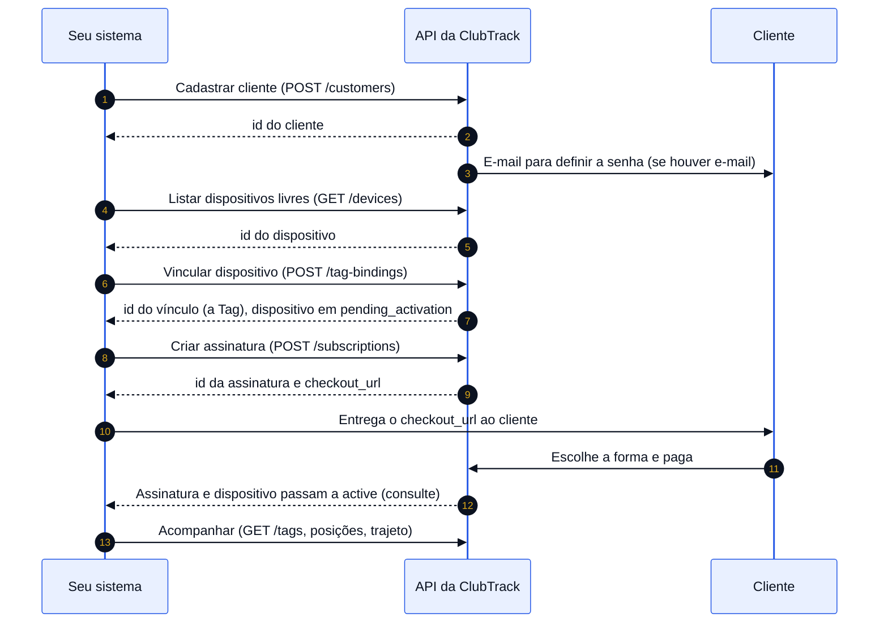

Vender uma Tag pela API é uma sequência curta: cadastrar o cliente, vincular um aparelho a ele, criar a assinatura e esperar a
liberação. Este guia mostra a ordem, o que cada chamada deixa pronto para a seguinte e onde o seu sistema precisa guardar
um identificador.

## Antes de começar

- Tenha uma [chave de API](/guias/autenticacao) e confirme-a com a [primeira chamada](/primeira-chamada).
- Cada passo grava de verdade. Não existe ambiente de teste, então faça a primeira venda com um cliente e um aparelho reais, ou
  com um cliente seu de teste que você reconheça (por exemplo, um `external_id` com prefixo próprio).
- Guarde, no seu sistema, o `id` que cada passo devolve. Os passos seguintes pedem esses identificadores.

## Passo a passo

<Steps>
  <Step title="Procure o cliente e, se ele não existir, cadastre">
    Procure pelo identificador do seu sistema com `filter[external_id]` em
    [Listar clientes](/referencia/clientes-e-enderecos/listar-clientes). Se não achar,
    [cadastre o cliente](/referencia/clientes-e-enderecos/cadastrar-cliente). Guarde o `id` devolvido.

    Atenção ao e-mail: se você informar um, a ClubTrack envia ao cliente, na hora, a mensagem para ele definir a senha de acesso.
    Sem e-mail, nada é enviado. O e-mail é único em toda a ClubTrack.
  </Step>

  <Step title="Cadastre o endereço, se for preciso">
    O cadastro do cliente não recebe endereço. Cadastre com [Cadastrar endereço](/referencia/clientes-e-enderecos/cadastrar-endereco) e marque o principal com
    [Definir endereço principal](/referencia/clientes-e-enderecos/definir-endereco-principal).
  </Step>

  <Step title="Escolha um aparelho livre">
    [Listar dispositivos](/referencia/rastreamento/listar-dispositivos) com `filter[assignedToPartner]=1` mostra o que está com você,
    sem cliente. Anote o `id` ou o número de série do aparelho escolhido.
  </Step>

  <Step title="Vincule o aparelho ao cliente">
    [Vincular dispositivo](/referencia/vinculos-e-campos/vincular-dispositivo) com o `device_serial` e o `customer_id`. O resultado é
    um vínculo, que a API chama de Tag. Guarde o `id` do vínculo.

    Neste ponto o aparelho passa a `pending_activation` (aguardando a assinatura) e **ainda não informa posição**. Se você usa
    [campos personalizados](/guias/campos-personalizados), é a hora de gravar placa, chassi ou outro dado do bem na Tag.
  </Step>

  <Step title="Crie a assinatura">
    [Criar assinatura](/referencia/comercial/criar-assinatura) liga um plano ao vínculo. Para escolher o plano, use
    [Listar planos](/referencia/comercial/listar-planos). Na cobrança por assinatura, a resposta traz o `checkout_url`, a página em que
    **o cliente** escolhe a forma de pagamento (cartão, boleto, Pix ou Pix Automático) e paga. A API não envia essa mensagem ao
    cliente: quem entrega o `checkout_url` é o seu sistema. Use o endereço exatamente como veio; não monte nem fixe esse endereço.
  </Step>

  <Step title="Acompanhe a liberação">
    [Consultar assinatura](/referencia/comercial/consultar-assinatura) mostra a situação da cobrança e
    [Consultar dispositivo](/referencia/rastreamento/consultar-dispositivo) mostra o `status` do aparelho. Quando o aparelho vai a
    `active`, a localização está liberada e a Tag aparece em [Listar Tags](/referencia/rastreamento/listar-tags).
    Se o cliente perder o link de pagamento, [reenvie-o](/referencia/comercial/reenviar-link-de-pagamento).
  </Step>
</Steps>

## O modelo de cobrança do seu parceiro muda o fim da história

Cada parceiro tem um modelo de cobrança, definido pela ClubTrack, e ele decide **quando a localização é liberada** e **quais Tags
você enxerga**.

<Tabs>
  <Tab title="Por assinatura (per_subscription, o padrão)">
    O cliente paga, e o pagamento confirmado libera o aparelho. A assinatura nasce `pending`, sem cobrança, e o aparelho fica em
    `pending_activation`. Quando o pagamento do primeiro ciclo é confirmado, a assinatura e o aparelho passam a `active`, e a Tag passa
    a aparecer nas listagens de Tags, trajeto e distância. O seu parceiro nunca processa o pagamento do cliente.

    Enquanto não houver assinatura ativa, a Tag fica fora de [Listar Tags](/referencia/rastreamento/listar-tags), e as chamadas de
    [trajeto](/referencia/rastreamento/consultar-trajeto) e [distância](/referencia/rastreamento/consultar-distancia) dessa Tag
    respondem `404`.
  </Tab>
  <Tab title="Consolidada pós-paga (consolidated_postpaid)">
    O parceiro é faturado pela ClubTrack depois, no fechamento do ciclo, e não há cobrança ao cliente nem página de pagamento. A
    assinatura nasce `active` na mesma chamada, o aparelho é ativado na hora, e toda Tag com vínculo ativo aparece nas listagens,
    sem depender de uma assinatura paga.
  </Tab>
</Tabs>

O modelo do seu parceiro aparece no campo `billing_model` de [Consultar o perfil do parceiro](/referencia/conta-e-equipe/consultar-perfil).

## Depois da venda

- **Ler a posição.** [Listar Tags](/referencia/rastreamento/listar-tags) mostra quais Tags estão comunicando. Para a última posição,
  use [Última posição](/referencia/rastreamento/ultima-posicao). Para o percurso, [Consultar trajeto](/referencia/rastreamento/consultar-trajeto).
- **Receber avisos.** Se os seus clientes criam cercas no aplicativo, o [webhook](/guias/webhook) avisa o seu sistema quando um aparelho
  entra ou sai.
- **Manter os dados do bem.** Os [campos personalizados](/guias/campos-personalizados) guardam placa, chassi e outros dados na Tag.

## Se um passo falha no meio

Cada passo é independente, então dá para retomar de onde parou, desde que você consulte antes de repetir.

| Falhou em | O que conferir antes de repetir |
|---|---|
| Cadastrar cliente | Procure pelo `external_id`. O cliente pode ter sido criado. |
| Vincular dispositivo | Consulte o aparelho: se está em `pending_activation`, o vínculo foi feito. |
| Criar assinatura | Repetir é seguro quando a primeira chamada funcionou: o vínculo já está numa assinatura em vigor, e a segunda responde `409`. Para achar a que foi criada, use [Listar assinaturas](/referencia/comercial/listar-assinaturas) e procure o vínculo em `tag_binding_ids`. |
